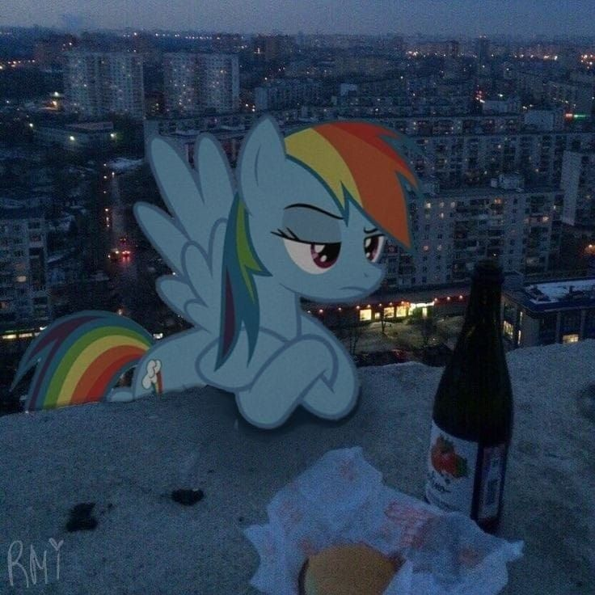
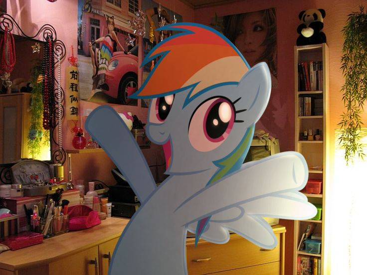
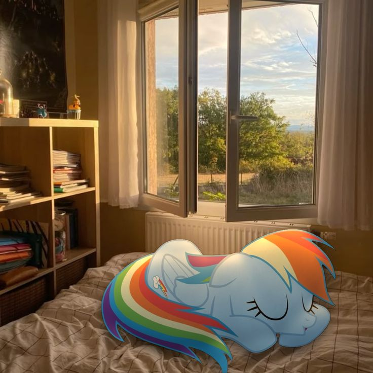

---
# Leave the homepage title empty to use the site title
title: ''
summary: ''
date: 2026-10-12
type: landing

sections:
  - block: resume-biography-3
    id: bio
    content:
      # Choose a user profile to display (a folder name within `content/authors/`)
      username: me
      text: ''
      # Show a call-to-action button under your biography? (optional)
      button:
        text: Download CV
        url: uploads/resume.pdf
      headings:
        about: ''
        education: ''
        interests: ''
    design:
      # Use the new Gradient Mesh which automatically adapts to the selected theme colors
      background:
        gradient_mesh:
          enable: false

      # Name heading sizing to accommodate long or short names
      name:
        size: md # Options: xs, sm, md, lg (default), xl

      # Avatar customization
      avatar:
        size: large # Options: small (150px), medium (200px, default), large (320px), xl (400px), xxl (500px)
        shape: circle # Options: circle (default), square, rounded

  - block: markdown
    id: education
    content:
      title: 'Education'
      subtitle: ''
      text: |-
        placeholder
    design:
      columns: '1'

  - block: markdown
    id: skills
    content:
      title: 'Skills'
      subtitle: ''
      text: |-
        placeholder
    design:
      columns: '1'

  - block: markdown
    id: projects
    content:
      title: 'Projects (click images for more info)'
      subtitle: ''
      text: |-
        

        

        
        

        <h3>Joro</h3>
        
Info of the project. Info of the project. Info of the project. Info of the project. Info of the project. Info of the project. Info of the project. Info of the project. Info of the project. Info of the project. Info of the project. Info of the project. Info of the project. Info of the project. Info of the project. Info of the project.

        

        

        

        
        

        <h3>Game 2</h3>
        
Info of the project. Info of the project. Info of the project. Info of the project. Info of the project. Info of the project. Info of the project. Info of the project. Info of the project. Info of the project. Info of the project. Info of the project. Info of the project. Info of the project. Info of the project. Info of the project.

        

        

        

        
        

        <h3>Game 3</h3>
        
Info of the project. Info of the project. Info of the project. Info of the project. Info of the project. Info of the project. Info of the project. Info of the project. Info of the project. Info of the project. Info of the project. Info of the project. Info of the project. Info of the project. Info of the project. Info of the project.

        

        

        

    design:
      columns: '1'
      

  - block: markdown
    id: contact
    content:
      title: 'Contact Me'
      subtitle: ''
      text: |-
        placeholder
    design:
      columns: '1'
---